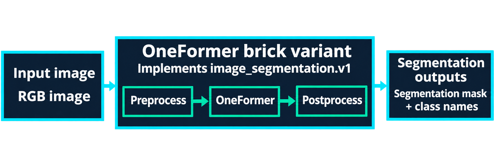

This Learning Path assumes that you have a basic understanding of, and experience using, Compute Flow. For an introduction, complete the [Get started with Compute Flow Learning Path](https://learn.arm.com/learning-paths/servers-and-cloud-computing/compute-flow-getting-started/). 

[//]: # (This URL will be available once that Learning Path is published.)

## Why author your own brick?

Authoring a brick lets you extend Compute Flow to meet your application's needs:

- Integrate a model that existing brick implementations do not support.
- Reuse your model integration across applications and share it with other developers.
- Tailor inference to your target hardware and performance requirements.

Compatible checkpoints, model sizes, and quantization levels can share a brick implementation through separate model packages.

Use an existing Brick API when its required inputs and outputs match your application. This lets applications use the existing CLI and swap compatible brick variants without changing application code. If no API represents the required capability, define a new brick type and its Brick API before implementing the brick.

## High-level steps to author your own brick

Brick authoring comprises two main areas to focus on:

- Creating a model package comprising exported models, a manifest, labels, and samples
- Implementing inference code that loads the manifest and connects model runners

## Worked example

In this learning path, you will use the MIT-licensed image-segmentation model [OneFormer swin tiny](https://huggingface.co/shi-labs/oneformer_ade20k_swin_tiny) as an educational example.

First, check whether an existing Brick API represents your task. A Brick API is the versioned, model-independent public contract for a brick type. It specifies the input and output tensors that an application exchanges with the brick. For semantic segmentation, inspect the [`image_segmentation.v1`](https://github.com/ARM-software/compute-flow/blob/main/brick_apis/image_segmentation.v1.json) brick API below.

```json
{
    "name": "image_segmentation.v1",
    "description": "Assigns one semantic class to each pixel of an RGB image.",
    "inputs": {
        "image": {
            "index": 0,
            "dtype": "float32",
            "shape": ["#num_channels", "#input_height", "#input_width"],
            "description": "RGB image in planar CHW format with values normalized to [0, 1]. Channels are ordered as Red, Green, then Blue."
        }
    },
    "outputs": {
        "mask": {
            "index": 0,
            "dtype": "int32",
            "shape": ["#input_height", "#input_width"],
            "description": "One class ID per input pixel, in row-major order. IDs are zero-based row indices into class_name; variants must remap sparse model IDs."
        },
        "class_name": {
            "index": 1,
            "dtype": "uint8",
            "shape": ["#num_classes", "#max_name_length"],
            "description": "UTF-8 class names indexed by mask class ID, padded with zero bytes. Names are not required to be unique."
        }
    }
}
```

Inspect the API's input and output requirements. The output mask must match the input image's height and width and use `int32` class IDs. The number of classes can vary, but names must be UTF-8, stored as zero-padded byte rows. Each mask ID selects a row in this table.

Check the model documentation, configuration, and example outputs against the contract:

1. **Input:** Confirm that the processor can accept the API's `float32` RGB image in CHW order and `[0, 1]` range. Identify any additional resizing and normalization needed inside the brick.
2. **Mask:** Confirm that semantic predictions can be restored to the input image's height and width and returned as `int32` class IDs.
3. **Class names:** Find the model's label mapping. Check that each mask ID can index a corresponding UTF-8 name in the zero-padded class-name table.

The [OneFormer model-card example](https://huggingface.co/shi-labs/oneformer_ade20k_swin_tiny) demonstrates semantic segmentation and restoring the output dimensions. Inspect its processor configuration and label mapping.

Next you will, run the model to verify tensor types, shapes, and values that inspection alone cannot confirm.




## What you've learned

You understand when to author a brick and its two parts: a model package and inference code. You can compare a model's inputs and outputs with an existing Brick API to assess whether it fits. Next, set up your environment to run OneFormer.
