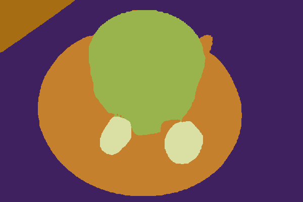

## Install and build

Return to the Compute Flow environment:

```bash
cd "$CF"
source .venv/bin/activate
```

Register the GitHub repository and refresh the available bricks. Git discovery uses versioned
release tags rather than the latest `main` commit:

```bash
compute-flow registry add https://github.com/kieranhejmadi01/OneFormer-Brick.git
compute-flow update
```

Install the model package declared in `info.json`. This also installs the brick source if it isn't already installed:

```bash
compute-flow model install image_segmentation:one-former oneformer-swin-tiny-ade20k-fp32
```

Check the installed brick's identity and available models:

```bash
compute-flow brick info image_segmentation:one-former
compute-flow model list image_segmentation:one-former
```

Build Compute Flow and the installed brick for your host:

```bash
compute-flow build native
```

## Segment a sample image

Run the C++ CLI on the packaged coffee image:

```bash
PACKAGE_DIR="$(compute-flow model path image_segmentation:one-former oneformer-swin-tiny-ade20k-fp32)"
./build_native/image_segmentation_cli \
  -m "$PACKAGE_DIR/oneformer_manifest.json" \
  -i @sample/coffee_landscape.png -o "$WORK/output/cpp.png" -t 1
```

Run the same sample through the Python CLI:

```bash
python -m cli_examples.image_segmentation_cli \
  -m "$PACKAGE_DIR/oneformer_manifest.json" \
  -i @sample/coffee_landscape.png -o "$WORK/output/python.png" -t 1
```

Open `cpp.png` and `python.png` in `$WORK/output`. The colored regions show the predicted semantic
classes at the input image's resolution.

")



## What you've accomplished

You've installed and built the OneFormer brick variant and generated segmentation images with the existing C++ and Python CLIs. Use this workflow to build and test your own variant against the same Brick API.
